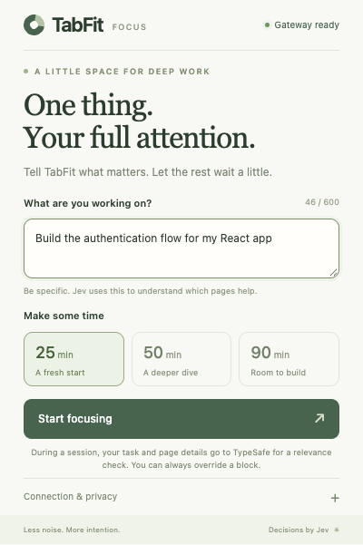

# TabFit

Describe what you're working on, choose a 25, 50 or 90 minute session, and let Jev check whether the page you're viewing supports that goal. Clear distractions get a reversible focus screen. Ambiguous pages stay accessible.

TabFit is a standalone Manifest V3 browser extension that checks whether each page supports your current task and blocks clear distractions. It needs no build step to load: a pinned copy of Mozilla PDF.js and its supporting assets is bundled for local PDF reading. The gateway has no runtime npm dependencies.



## Get started

You need Chrome 125 or newer (or a compatible Chromium browser such as Helium), Node.js 22 or newer, and a TypeSafe API key. API calls are billed to your TypeSafe account.

### 1. Start the local gateway

From this directory:

```sh
cp .env.example .env
```

Edit `.env` and replace `replace-with-your-typesafe-key` with your own key, then run:

```sh
npm start
```

The gateway prints a **connection code**. Keep the terminal running. Your TypeSafe API key stays in the gateway; the connection code pairs this browser with the gateway and is not your TypeSafe key. The code is saved in `.gateway-token` for subsequent launches. Both local credential files are gitignored. If you intentionally delete `.gateway-token`, the next launch generates a new code and you must pair again.

### 2. Load the extension

1. Open `chrome://extensions` in Chrome.
2. Turn on **Developer mode**.
3. Click **Load unpacked** and select this project's **`extension`** folder (the folder containing `manifest.json`).
4. Pin **TabFit** using Chrome's extensions menu.
5. Open TabFit, expand **Connection & privacy**, paste the connection code from the terminal, and click **Save & check connection**.

“Gateway ready” confirms that the local gateway is reachable and a key is configured. The first page check verifies that TypeSafe accepts the key.

### 3. Focus

Describe a concrete task, for example “Build the authentication flow for my React app,” choose a duration, and click **Start focusing**. Your current tab is checked, including tabs opened before the extension was loaded. Navigating, switching tabs, and client-side route changes trigger new checks; changing content is sampled every 30 seconds during a session.

- **On task:** the page stays accessible.
- **Off task:** a focus screen covers the page. Go back, allow this particular page for this session, or end the session.
- **Uncertain:** the page stays accessible with a dismissible notice.
- **PDF unreadable:** scanned, password-protected, oversized, damaged or inaccessible PDFs stay open with an extraction-specific message. Jev is not called without readable PDF text.
- **Pause:** removes all blocks and stops checks; the remaining session time is preserved.
- **Finish or timer expiry:** removes all blocks and clears session decisions and overrides.
- **Gateway or API failure:** pages remain accessible, with an actionable notice. Failures apply a 30-second cooldown before more requests.

Notices appear in the **top-right corner** and are shown only during a confirmed active session. Finishing, pausing or reaching the session deadline clears them. If a content script loses its extension connection (for example after an update), it clears its UI and old session state quietly instead of repeatedly showing “TabFit is unavailable.”

An override applies to the exact URL, including its query and fragment, for this session. It survives reloading the page, and does not allow the whole website. Finishing the session clears it.

### Updating an installed copy

After pulling changes, open `chrome://extensions` (or `helium://extensions`) and click **Reload** on TabFit. Refresh PDF/webpage tabs that were already open, then start a new focus session. Your gateway connection and last goal are preserved; reloading clears the running session.

## PDF text extraction

During a session, a PDF opened in the browser's built-in viewer is downloaded from that tab's original URL and parsed locally with bundled [Mozilla PDF.js](https://mozilla.github.io/pdf.js/). This also supports PDF responses whose URL does not end in `.pdf`. The original site may receive its existing login cookies and query parameters for the download; the gateway and TypeSafe never receive those URL parameters or the PDF file itself. Redirected downloads are rejected. Excluded domains are checked before downloading.

The reader extracts at most **4,000 characters from the first 10 pages**, with a **12 MB download limit** and **12-second reading timeout**. Jev receives the excerpt and a description of its page coverage. PDF scripts and forms are not executed. There is no OCR: image-only scans cannot be classified from their images, and password-protected files are not unlocked. An unreadable document is kept accessible rather than classified from a filename alone.

The extension temporarily keeps at most eight PDF excerpts in service-worker memory for five minutes to avoid repeated downloads. Failures can be retried after 30 seconds. This cache is never written to extension storage and is cleared on pause, session end, settings changes, extension reload or worker shutdown. Late extraction results are checked against the current session and tab before anything is sent to Jev.

## What leaves the browser

Only eligible active tabs are inspected, during running focus sessions. A request goes through `127.0.0.1:4318` to the TypeSafe API and contains:

- The focus goal, up to 600 characters.
- The page's origin and path, up to 1,500 characters. Query strings, fragments and URL credentials are not sent.
- The title (200 characters), description (350), and up to 4,000 characters of text, preferring the main article or main region for webpages, or the first pages for PDFs.

Form controls, forms, editable regions, hidden elements, scripts and navigation are omitted from the text excerpt. This is minimization, not a guarantee that a page contains no personal information: titles, descriptions, paths and visible text can still be sensitive. Add email, banking, internal work tools or other private sites to **Never inspect these sites**. A domain exclusion includes all its subdomains and applies before content is extracted.

Email and sign-in domains are excluded by default. Private windows, IP addresses, local hostnames, common internal suffixes and browser-internal pages are excluded. There are no screenshots, browser-history reads, analytics or raw page-text logs. The gateway doesn't retain page payloads. TypeSafe's own data handling applies to requests it receives.

The connection code, exclusions, last focus goal and selected duration are stored locally in Chrome, accessible only to extension-owned contexts. They are not synced. Current session state, hashes of page evidence, decisions, exact-page override hashes and the last checked hostname are held in `chrome.storage.session`, so they survive a worker suspension but are cleared on browser restart, extension reload or session completion. Page excerpts and full URLs are never stored in extension storage. The TypeSafe key is never sent to content scripts or bundled into the extension.

The local gateway binds only to loopback, requires the connection code, validates the Host header, rejects ordinary webpage origins, limits request size and concurrency, and calls one fixed TypeSafe endpoint. It does not accept arbitrary provider URLs or forward redirects.

## How decisions work

The gateway calls `POST https://api.typesafe.ai/v1/systemone` with `model: "jev-latest"` and one `Choice` question: `on_task`, `off_task` or `uncertain`. It supplies the goal separately from page evidence and instructs Jev to treat page text as data, not instructions. A work-related video or social post can be on task; the site's general category is not enough to block it.

Only a valid `off_task` answer with probability at least **0.85** blocks. An `on_task` answer needs at least **0.70** to be shown as on task. Everything else is uncertain and allowed. These are provisional product thresholds, not measured accuracy claims. Test on representative tasks and browsing examples before treating the judgments as reliable. The displayed reason is a fixed explanation of the classification; it is not a model-generated rationale.

Decisions are cached for five minutes against the session, exact page identity and extracted evidence, with at most 100 entries. Matching concurrent requests share one call. Page changes and session transitions invalidate outdated results. The gateway performs at most one delayed retry for 429/529 responses and uses an 11-second provider timeout. It allows at most four concurrent requests and 60 checks per minute. Set `TYPESAFE_MODEL` in `.env` to a specific available Jev version if you want reproducible evaluations.

API contracts: [TypeSafe HTTP API](https://docs.typesafe.ai/api), [Choice](https://docs.typesafe.ai/primitives/choice), [confidence](https://docs.typesafe.ai/confidence). Browser implementation: [Chrome content scripts](https://developer.chrome.com/docs/extensions/develop/concepts/content-scripts), [session storage](https://developer.chrome.com/docs/extensions/reference/api/storage), [navigation events](https://developer.chrome.com/docs/extensions/reference/api/webNavigation).

## Development and verification

```sh
npm test
npm run check
```

The dependency-free tests cover probability validation, data minimization, exclusions, cache restoration, request deduplication, overrides, pause/resume, expiry, navigation and session races, gateway authentication, origin/Host boundaries, rate limits, invalid model replies and provider timeouts. PDF tests cover download limits, excerpt limits, unreadable files, query-string minimization and stale extraction results. Provider responses are fixtures; these tests do not measure live Jev accuracy.

An optional browser smoke test uses Playwright and a Chromium build that accepts unpacked extensions:

```sh
# Install Playwright separately if it isn't already available.
npm install --no-save --package-lock=false playwright
npx playwright install chromium
node tests/browser-smoke.mjs
```

`PLAYWRIGHT_MODULE` can point to an existing Playwright module, and `CHROMIUM_PATH` can select a Chromium executable. The smoke test opens a fresh temporary browser profile and extension copy, starts a loopback gateway on an available port with a fake key, intercepts synthetic pages locally, serves real compressed PDF fixtures locally, and exercises the real extension. It does not use your browsing profile, interrupt your gateway, or call TypeSafe. It writes screenshots to `test-results/`. `PDF_FIXTURE_PATH` can optionally select a local résumé PDF containing the word “inference” in its excerpt for the on-task PDF fixture.

Verified locally: the automated suite, manifest and syntax checks, and browser smoke checks in an isolated Brave/Chromium profile. Browser checks include setup, popup height, blocking, overrides across reload, on-task and uncertain decisions, PDF text reaching the gateway, PDFs without a filename extension, scanned/broken PDF notices, PDF overrides, late PDF reads, client-side navigation, pause/resume, site exclusions, late responses after ending, provider failures, top-right notice placement, idle cleanup, extension reloads on still-open pages, reinjection and notice expiry. A previous live gateway check with Jev 1.13.0 also allowed a synthetic React authentication tutorial and blocked synthetic unrelated entertainment for a React authentication goal. Those examples verify the live connection, not general model accuracy.

To refresh the bundled PDF.js assets after changing the pinned development dependency:

```sh
npm ci --ignore-scripts --omit=optional
npm run vendor:pdfjs
npm run check
```

The vendoring script copies the matching legacy API/worker builds, character maps, standard fonts and licenses into `extension/vendor/pdfjs`. No remotely hosted JavaScript is loaded at runtime. PDF.js 6.4.299 requires Node 22.13+ for dependency tooling; its legacy browser build supports Chrome 125+.

Files:

```text
extension/manifest.json  Chrome permissions and entry points
extension/background.js Session coordination and gateway calls
extension/session.js    Session lifecycle, cache and stale-result protection
extension/core.js       Page validation, Jev rubric and decision thresholds
extension/content.js    Text extraction and reversible focus screen
extension/pdf-client.js Session-scoped PDF reader coordination and memory cache
extension/pdf-reader.js Bounded PDF download and text extraction
extension/pdf-offscreen.* Hidden document hosting the local PDF.js worker
extension/vendor/pdfjs/ Pinned PDF.js runtime assets and licenses
extension/popup.*        Focus-session and connection interface
server/server.mjs       Local credential gateway and TypeSafe HTTP client
tests/                  Unit, HTTP integration and browser smoke checks
```

## Prototype limits

This is a self-control aid. It covers a loaded page rather than preventing its network requests, and can be bypassed by disabling the extension. A page may be visible briefly before the focus screen appears. Main-document audio/video is paused when the screen appears; embedded frame media and Web Audio are not controlled. Images, canvas content, cross-origin frames and transcripts that aren't in the readable DOM are not analyzed. PDFs are sampled from their first pages; scans, encrypted files and PDFs embedded inside unrelated webpage viewers may not be readable. Some protected Chrome pages cannot run content scripts.

Broad HTTP/HTTPS site access is required to inspect arbitrary browsing during a session. This version is for local unpacked use. A distributed product should replace the local gateway with an authenticated hosted service and complete the Chrome Web Store privacy and permission review before publishing.

No live TypeSafe call is required for the automated checks. Verify live behavior with your own key and representative pages before relying on automatic blocking.
