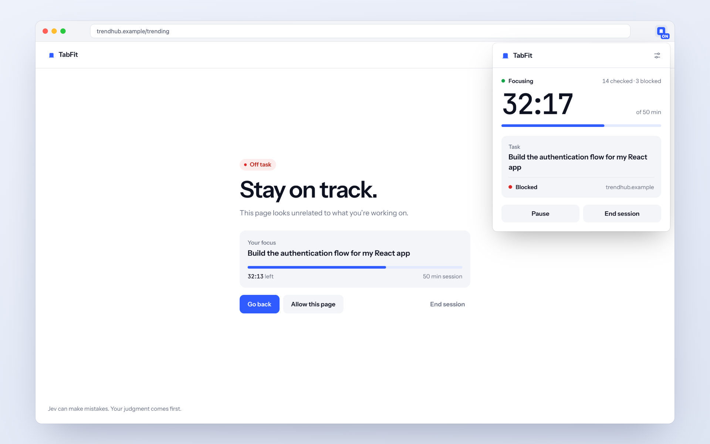
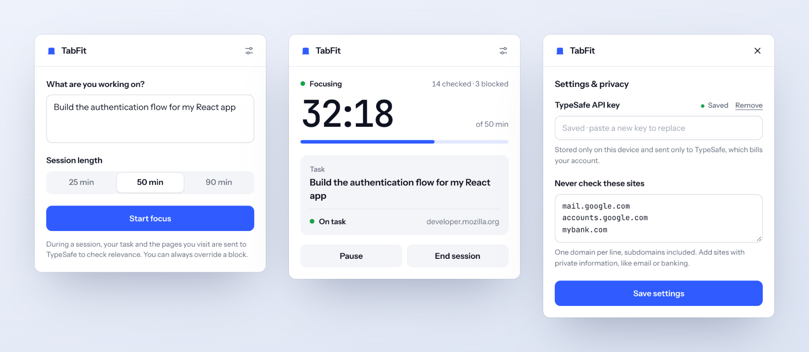

<p align="center">
  
</p>

<h1 align="center">TabFit</h1>

<p align="center">
  A focus timer that knows what you're working on.<br>
  Describe your task, start a session, and TabFit keeps off-task pages out of your way.
</p>

<p align="center">
  <sub>Powered by <strong>Jev</strong> from <a href="https://docs.typesafe.ai">TypeSafe</a></sub>
</p>

<p align="center">
  <picture>
    <source media="(prefers-color-scheme: dark)" srcset="docs/screenshots/hero-dark.png">
    
  </picture>
</p>

Most site blockers work from a list of banned websites, and lists don't know what you're doing: a YouTube video can be the tutorial you need, and a documentation site can be a rabbit hole. TabFit starts from your task instead. During a focus session it asks Jev, a model available through the [TypeSafe API](https://docs.typesafe.ai/api), whether the page you're viewing supports that task. Clear distractions get a focus screen; everything else stays open.

- **Judged against your task, not a category.** A work-related video or social post can be on task.
- **You stay in charge.** Go back, allow the page for this session, or end the session. Blocks are always reversible.
- **Cautious when unsure.** If Jev isn't confident, the page stays open with a small notice.
- **Reads PDFs locally.** PDFs are parsed on your device with bundled PDF.js; only a text excerpt is sent.
- **Private by design.** Only the active tab, only during a session. Email and sign-in sites are skipped, and you can add your own.
- **No server, no account.** The extension calls TypeSafe directly with your own API key. There are no analytics.

## How it works

<p align="center">
  <picture>
    <source media="(prefers-color-scheme: dark)" srcset="docs/screenshots/popup-dark.png">
    
  </picture>
</p>

1. **Describe your task.** Be concrete: “Build the authentication flow for my React app” works better than “coding”.
2. **Choose 25, 50 or 90 minutes** and click **Start focus**.
3. **Browse as usual.** Each page you open or switch to is checked, including route changes inside web apps. Pages stay usable while they're checked.

| Jev's answer | What happens |
| --- | --- |
| On task | Nothing. The page stays open. |
| Off task | A focus screen covers the page. Go back, allow this page, or end the session. |
| Unsure | The page stays open with a dismissible notice. |
| Check failed | The page stays open, and a notice explains what went wrong. |

**Pause** removes all blocks and keeps your remaining time. **End session**, or reaching the end of the timer, removes all blocks and clears the session's decisions and allowed pages.

## Install

TabFit isn't in the Chrome Web Store yet, so you load it as an unpacked extension. You need Chrome 125 or newer (or a compatible Chromium browser such as Helium) and your own [TypeSafe](https://docs.typesafe.ai/api) API key. Page checks are billed to your TypeSafe account.

1. Download this repository:

   ```sh
   git clone https://github.com/ahmadkaouk/tabfit.git
   ```

2. Open `chrome://extensions` and turn on **Developer mode**.
3. Click **Load unpacked** and select the **`extension`** folder (the one containing `manifest.json`).
4. Pin **TabFit** from the extensions menu.

No build step, server or Node installation is needed to use it.

### Add your API key

Open TabFit and click **Add API key** in the top-right corner. Paste your key into **TypeSafe API key** and click **Save settings**.

- The key is stored only in this browser profile and is sent only to TypeSafe.
- **Saved** means the key is stored. TypeSafe verifies it on your first page check; if it's rejected, a notice explains how to update it and pages stay open.
- Leaving the field blank on later saves keeps your key; pasting a new one replaces it. **Remove** deletes it and pauses any running session.

### Update

Run `git pull`, then click **Reload** on TabFit in `chrome://extensions`. Your key, settings and last task are kept; a running session is cleared.

## Privacy

TabFit only looks at the active tab, and only during a focus session. Each check sends TypeSafe:

- your task (up to 600 characters);
- the page's address, without its query string or fragment;
- the page title, description and up to 4,000 characters of visible text.

Form fields, editable areas, screenshots, cookies and browsing history are never sent. Private windows, local and internal addresses, browser pages, and common email and sign-in sites are never checked. Add any other site under **Never check these sites**; subdomains are included. Nothing is sent without a saved key and a running session.

Page text can still contain personal information, so exclude sites you want kept private. The full data flow is described under [Technical details](#technical-details).

## Limitations

- TabFit is a self-control aid, not a lock. It covers a page rather than blocking its network requests, and disabling the extension turns it off.
- An off-task page is visible for a second or two, until Jev answers, before the focus screen appears.
- Only text is analyzed. Images, canvas content, cross-origin frames and transcripts that aren't in the page's readable text are not. Media inside embedded frames and Web Audio aren't paused.
- PDFs are sampled from their first 10 pages. Scans (there is no OCR), password-protected files and PDFs inside other sites' viewers may not be readable.
- Some protected browser pages can't run extensions, so they can't be covered.
- Jev can be wrong. The decision thresholds are provisional product choices, not measured accuracy. Try it on your own tasks before relying on it.

## Technical details

<details>
<summary><strong>What leaves the browser</strong></summary>

Only eligible active tabs are inspected, during running focus sessions. The background worker sends an HTTPS request directly to the TypeSafe API containing:

- The focus goal, up to 600 characters.
- The page's origin and path, up to 1,500 characters. Query strings, fragments and URL credentials are not sent.
- The title (200 characters), description (350), and up to 4,000 characters of text, preferring the main article or main region for webpages, or the first pages for PDFs.

Form controls, forms, editable regions, hidden elements, scripts and navigation are omitted from the text excerpt. This is minimization, not a guarantee that a page contains no personal information: titles, descriptions, paths and visible text can still be sensitive. A domain exclusion includes all its subdomains and applies before content is extracted.

`mail.google.com`, `outlook.live.com`, `outlook.office.com`, `accounts.google.com` and `login.microsoftonline.com` are excluded by default. Private windows, IP addresses, local hostnames, common internal suffixes and browser-internal pages are always excluded. There are no screenshots, browser-history reads, analytics or raw page-text logs. TypeSafe's own data handling applies to requests it receives.

The API key, exclusions, last focus goal and selected duration are stored locally in `chrome.storage.local`, accessible only to extension-owned contexts, and are not synced. Current session state, hashes of page evidence, decisions, hashes of allowed pages and the last checked hostname are held in `chrome.storage.session`, so they survive a worker suspension but are cleared on browser restart, extension reload or session end. Page excerpts and full URLs are never written to extension storage.

Popup state responses only say whether a key is saved; they never return it. Content scripts and websites can't read the key through extension storage or messaging, and it is sent only in the `Authorization` header to TypeSafe. Browser storage is not an OS keychain: someone with access to your browser profile could retrieve it. No shared developer key is bundled.

The TypeSafe endpoint is fixed in code. Requests omit cookies and referrers, reject redirects, bound the response size and never forward raw provider error bodies. Page checks are cancelled when you pause, end the session, remove the key or change settings.

</details>

<details>
<summary><strong>How decisions work</strong></summary>

The background worker calls `POST https://api.typesafe.ai/v1/systemone` with `model: "jev-latest"` and one `Choice` question whose answers are `on_task`, `off_task` or `uncertain`. It supplies the goal separately from the page evidence and instructs Jev to treat page text as data, not instructions. The site's general category is not enough to block a page.

Only a valid `off_task` answer with probability of at least **0.85** blocks. An `on_task` answer needs at least **0.70** to be shown as on task. Everything else is treated as uncertain and allowed. The reason shown on the focus screen is a fixed explanation of the classification, not a model-generated rationale.

Decisions are cached for five minutes against the session, the exact page and the extracted evidence, with at most 100 entries. Matching concurrent requests share one call. Page changes and session transitions invalidate outdated results. Page content is re-sampled every 30 seconds during a session.

The API client retries a 429 or 529 response once after a short delay and uses an 11-second timeout. It allows at most four concurrent requests and 60 checks per minute; TypeSafe also enforces its own limits. A failed check pauses further requests for 30 seconds, and the notice keeps showing the original cause during that time.

Allowing a page applies to that exact URL, including its query and fragment, for the current session. It survives a reload and doesn't allow the rest of the site.

References: [TypeSafe HTTP API](https://docs.typesafe.ai/api), [Choice](https://docs.typesafe.ai/primitives/choice), [confidence](https://docs.typesafe.ai/confidence), [Chrome content scripts](https://developer.chrome.com/docs/extensions/develop/concepts/content-scripts), [storage](https://developer.chrome.com/docs/extensions/reference/api/storage), [navigation events](https://developer.chrome.com/docs/extensions/reference/api/webNavigation).

</details>

<details>
<summary><strong>PDF text extraction</strong></summary>

During a session, a PDF opened in the browser's built-in viewer is downloaded from that tab's original URL and parsed locally with bundled [Mozilla PDF.js](https://mozilla.github.io/pdf.js/). This also works for PDF responses whose URL doesn't end in `.pdf`. The original site may receive its usual login cookies and query parameters for the download; TypeSafe never receives those URL parameters or the PDF file itself. Redirected downloads are rejected, and excluded domains are checked before downloading.

The reader extracts at most **4,000 characters from the first 10 pages**, with a **12 MB download limit** and a **12-second reading timeout**. Jev receives the excerpt and a description of which pages it covers. PDF scripts and forms are not executed. Scanned, password-protected, oversized or damaged PDFs stay open with a message explaining why; Jev is never asked to judge a PDF from its filename alone.

At most eight PDF excerpts are kept in service-worker memory for five minutes to avoid repeated downloads. This cache is never written to extension storage and is cleared on pause, session end, settings changes, extension reload or worker shutdown. Late extraction results are checked against the current session and tab before anything is sent.

</details>

## Development

Development needs Node.js 22 or newer. The extension itself has no build step.

```sh
npm test        # unit tests
npm run check   # manifest assets and JavaScript syntax
```

The unit tests are dependency-free. They cover probability validation, data minimization, exclusions, caching, request deduplication, overrides, pause and resume, expiry, navigation and session races, API authentication failures, rate limits, invalid model replies, cancellation, timeouts and PDF limits. Provider responses are fixtures, so these tests don't measure Jev's accuracy.

An optional browser smoke test loads the extension into a fresh temporary profile with Playwright, replaces the TypeSafe endpoint with a local mock, and exercises the whole flow: key handling, sessions, blocks, overrides, PDFs, single-page-app navigation, provider failures and extension reloads. It never uses your browsing profile or calls TypeSafe.

```sh
npm install --no-save --package-lock=false playwright
npx playwright install chromium
node tests/browser-smoke.mjs
```

`PLAYWRIGHT_MODULE` can point to an existing Playwright module and `CHROMIUM_PATH` to a Chromium executable. Screenshots are written to `test-results/`. `PDF_FIXTURE_PATH` can select a local PDF containing the word “inference” for the on-task PDF case.

To refresh the bundled PDF.js after changing its pinned version:

```sh
npm ci --ignore-scripts --omit=optional
npm run vendor:pdfjs
npm run check
```

No remotely hosted code or web fonts are loaded at runtime. `extension/vendor/pdfjs` holds PDF.js and its licenses. `extension/vendor/fonts` holds the latin and latin-ext subsets of Instrument Sans and JetBrains Mono; the popup loads them with `@font-face`, and the focus screen receives them from the background worker because shadow roots ignore `@font-face`.

```text
extension/manifest.json    Permissions and entry points
extension/background.js    Session coordination, settings and API key access
extension/jev-client.js    TypeSafe requests, cancellation and error handling
extension/session.js       Session lifecycle, cache and stale-result protection
extension/core.js          Page validation, Jev rubric and decision thresholds
extension/content.js       Text extraction, focus screen and notices
extension/pdf-client.js    PDF reader coordination and memory cache
extension/pdf-reader.js    Bounded PDF download and text extraction
extension/pdf-offscreen.*  Hidden document hosting the PDF.js worker
extension/popup.*          Popup: sessions, API key and privacy settings
extension/vendor/          Bundled PDF.js and fonts, with their licenses
scripts/                   Asset checks, PDF.js vendoring and icon generation
tests/                     Unit tests and the browser smoke test
docs/screenshots/          Images used in this README
```

## License

TabFit is released under the [MIT License](LICENSE). Bundled third-party components keep their own licenses: [PDF.js](extension/vendor/pdfjs/LICENSE) (Apache 2.0), and [Instrument Sans and JetBrains Mono](extension/vendor/fonts/LICENSE) (SIL Open Font License 1.1).
